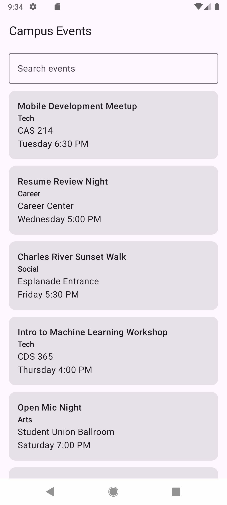
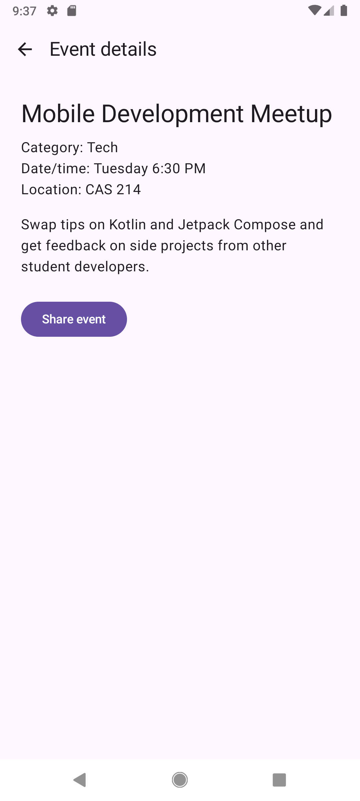

# Campus Event Explorer

**Name:** Suchir Jolapara
**Assignment:** CS501 — Individual Assignment 3: Campus Event Explorer

## Description

A small Android app built with Kotlin and Jetpack Compose. Users browse a list of campus events, search by title or category, open an event to see its details, and share it with another app using the Android share sheet.

## Running the App

1. Open the project in Android Studio and let Gradle sync.
2. Run it on an emulator (tested on a Medium Phone, API 28).

## Screenshots

## Questions

**1. Why does the route contain an event ID instead of the complete event object?**
The route is serialized into the back stack, so it should stay small and stable. An ID is just a `Long`, and the detail destination looks the event up from the single event list, so it never shows a stale copy.

**2. Which composable owns the search state?**
`EventListRoute` owns `query`. `EventListScreen` is stateless: it receives the query and an `onQueryChange` callback, and the filtered list is derived from `query` each time instead of being stored.

**3. Why does the search value use `rememberSaveable`?**
Rotation recreates the Activity, and plain `remember` would reset the text to empty. `rememberSaveable` saves the value, so the search text survives rotation and is still there after returning from a detail screen.

**4. What happens to the back stack when an event is selected?**
`navigate(EventDetail(id))` pushes the detail entry on top of the list entry. The list stays underneath, and Back or Up pops the detail off so the list is shown again.

**5. How does the UI request navigation without directly accessing the `NavController`?**
The screens only receive lambdas such as `onEventSelected` and `onBack`. `CampusEventApp` creates the `NavController` and passes in lambdas that call `navigate` and `popBackStack`, so the screens just report what the user did.

**6. What makes the Share action an implicit intent?**
It uses `ACTION_SEND` with `text/plain` data instead of naming a specific app or component. Android decides which apps can handle it, and `Intent.createChooser()` shows the share sheet.

## Generative-AI Disclosure

I used Claude throughout this assignment. Claude helped me understand the assignment is a detailed way along with recognizing the library and gradle files changes. It also helped me write a better README.